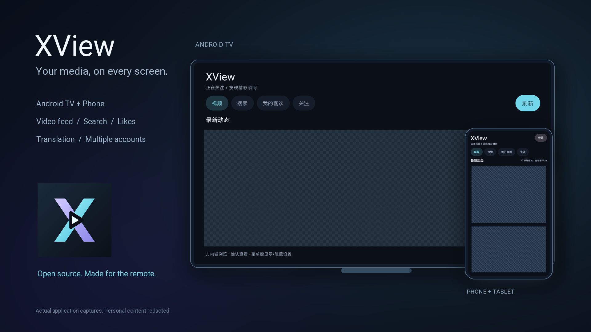
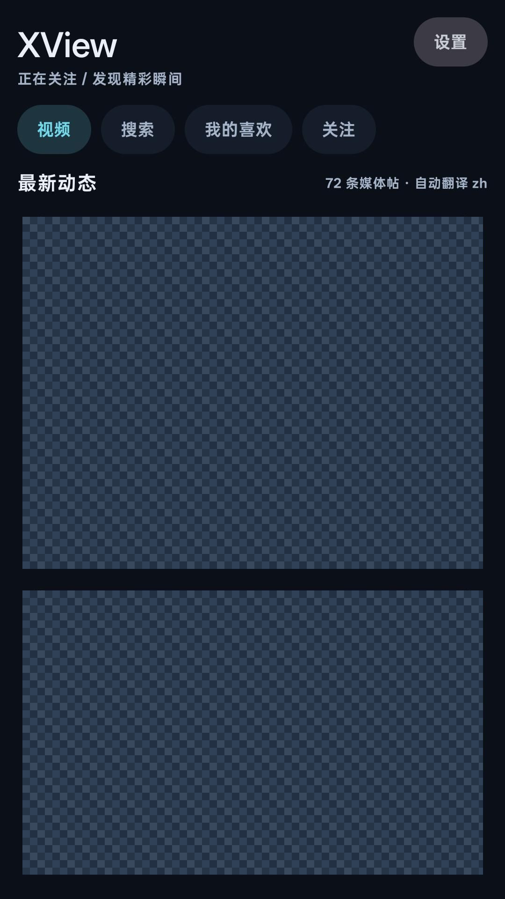
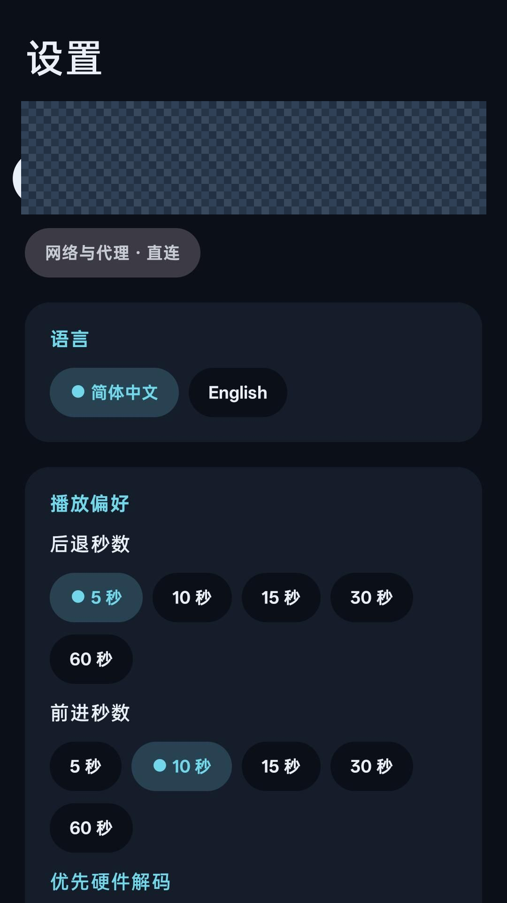
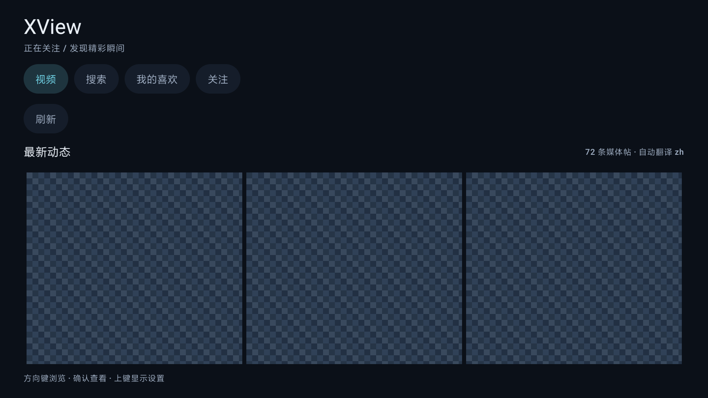

<p align="center"></p>

# XView

<p align="center"></p>

[](https://github.com/TanCan1998/xview-tv/actions/workflows/ci.yml)
[](https://github.com/TanCan1998/xview-tv/releases/tag/v1.0.1)
[](docs/compatibility/android-tv.md)
[](LICENSE)

A media-first X client for Android phones, tablets, Android TV and Google TV built with Kotlin and Compose for TV.

[中文说明](README_zh-CN.md) · [Product design](docs/design/xview-tv.md) · [Roadmap](docs/development/roadmap.md)

There is one application, `io.github.tancan1998.xviewtv`, with no Demo flavor. On TV, press Menu to show or hide Settings. Phones show a persistent Settings entry. Login and Proxy live inside Settings; Back returns from a child page to Settings, then Home.

Implemented: Chinese/English UI (first launch selects a supported system language, falls back to English, and saves it; Settings lists supported languages only), responsive phone/tablet/TV layouts, direct complete-Cookie entry on phones with identity verification and confirmation, and LAN QR pairing with a single complete Cookie input, device-code comparison, encrypted submission, web-session identity verification, explicit TV account confirmation, Android Keystore storage, cold-start restore, manual revalidation and local logout. The TV serves its bundled pairing page for at most 180 seconds and closes the port on leaving Login or backgrounding. No public relay, hosted HTTPS page or companion app is required. The app never reads another browser's Cookie database.

Direct, unauthenticated HTTP and SOCKS5 proxy settings are validated and saved locally. Images, translation and Media3 use the same explicit policy without automatic direct fallback. Credentials are sent only to same-origin X web endpoints, never media hosts. The following-account media timeline now supports dynamically discovered GraphQL operations, cursor pagination, deduplication, modern lazy cards, X/Grok automatic translation to the current device language, and open-source Media3 controls with quality, speed and seek bar. Playback prefers hardware codecs, supports temporary right-side hold speed boosts, left/right double-tap seek with independent 5/10/15/30/60-second preferences, and previous/next video within the filtered feed. Phone lists use pull-to-refresh without a refresh button; TVs keep the button. Palette, radii, supported languages and UI strings live in shared resources. No local sensitive-content hiding remains. The video-only navigation adds global X video search, the current account’s liked videos, and a paginated following list that opens each creator’s original and reposted videos. Photo filters and the full-screen photo page have been removed. Search, likes, following and creator-media endpoints and cursors were tested locally with the saved account; see [API evidence](docs/development/video-library-api.md). Up to 20 accounts can now be encrypted and saved, switched without re-entering Cookie, or removed individually; existing single-account storage is retained and migrated on the next write. Switching recreates clients and clears the previous account UI/cache. TV playback uses hidden Left/Right repeat seek and OK play/pause, a finite control timeout, and compact external speed/queue buttons. See the current phone and TV installation evidence in [verification](docs/development/verification.md); see [media design](docs/development/media-playback.md).

API23 (Android 6.0) is the installation minimum for phones and TVs; account storage uses Android Keystore without a plaintext fallback. Real LAN form submission, identity confirmation, encrypted storage, restore, revalidation and logout were exercised on Xiaomi MiTV-ANSP0 (Android9/API28, 32-bit ARM). Other devices are unverified. See [verification](docs/development/verification.md) and [security boundaries](docs/adr/006-qr-cookie-login.md). If scanning reports `ERR_LOCAL_NETWORK_PERMISSION_MISSING`, allow local-network access in the phone browser's application permissions and generate a new QR code.

## Screenshots

Actual 1.0.0 runtime captures. Account identities, avatars, post text, video thumbnails and other personal content are irreversibly redacted. Navigation, card boundaries, controls and TV focus remain visible. All image paths are relative to this repository.

| Phone home | Phone settings |
| --- | --- |
|  |  |



## Build

JDK17, SDK37 / Build Tools36.0.0, Gradle9.9.1, AGP9.5.1 and Kotlin2.4.21 with built-in Kotlin; CI pins Node26.13.1. See [GitHub build setup](docs/development/github-build.md).

```sh
python3 tools/scripts/verify_project.py
node web/pairing/tests/node.mjs
node web/pairing/tests/lan-node.mjs
sh ./gradlew :core:network:test :core:domain:test :core:provider:test :provider:demo:test :app:lintDebug :app:assembleDebug
```

Debug output: `app/build/outputs/apk/debug/app-debug.apk`. Build the compact local review artifact with `sh ./gradlew :app:assembleOptimized :app:lintOptimized`: `app/build/outputs/apk/optimized/app-optimized.apk`. It uses R8 and resource shrinking, is not debuggable, keeps both languages and all ABIs, and uses the existing local debug certificate for in-place testing. The published APK is built by GitHub Actions and re-signed with the existing certificate held in encrypted repository Secrets; signing keys are not in source control. Release also shrinks; independent builders should configure their own signing policy. Configure `ANDROID_HOME`; use `sh ./gradlew` on shared mounts. The verified ARM64 Alpine offline runner is documented in [verification](docs/development/verification.md).

The nine-module [architecture](docs/architecture/overview.md) packages `feature:home` as the real media UI; `provider:demo` remains deterministic test fixtures only and is not packaged. No real credentials, signing keys or personal response bodies are committed. [Source](https://github.com/TanCan1998/xview-tv) · [Download 1.0.1](https://github.com/TanCan1998/xview-tv/releases/tag/v1.0.1). Apache-2.0; [third-party licenses](licenses/third-party/README.md).

## Community

[LINUX DO](https://linux.do/) is a technology community built on sincerity, friendliness, unity and professionalism. We recognize its commitment to open-source exchange and welcome community feedback and ideas for XView.
