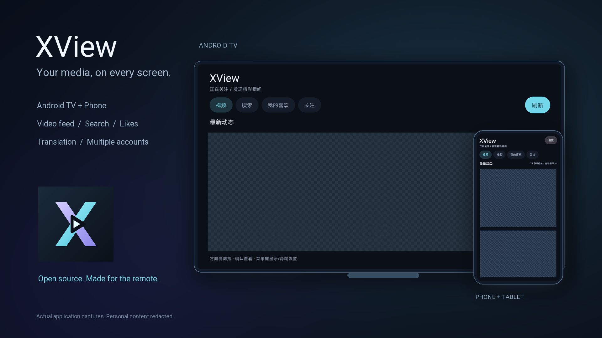
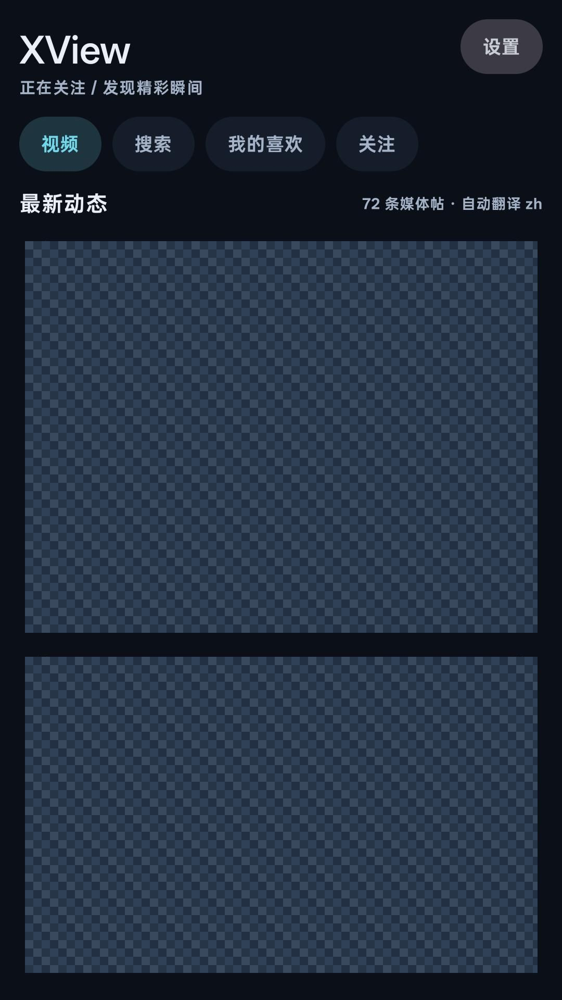
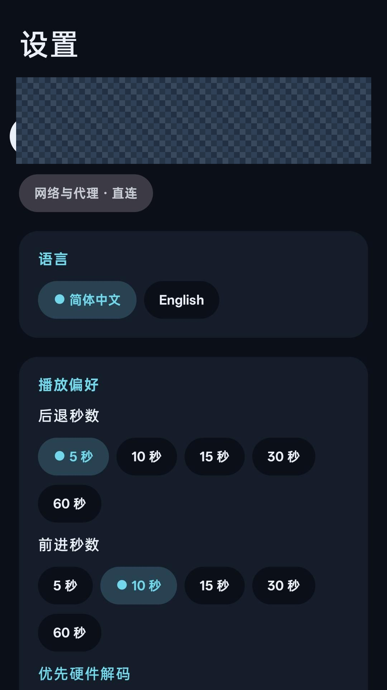
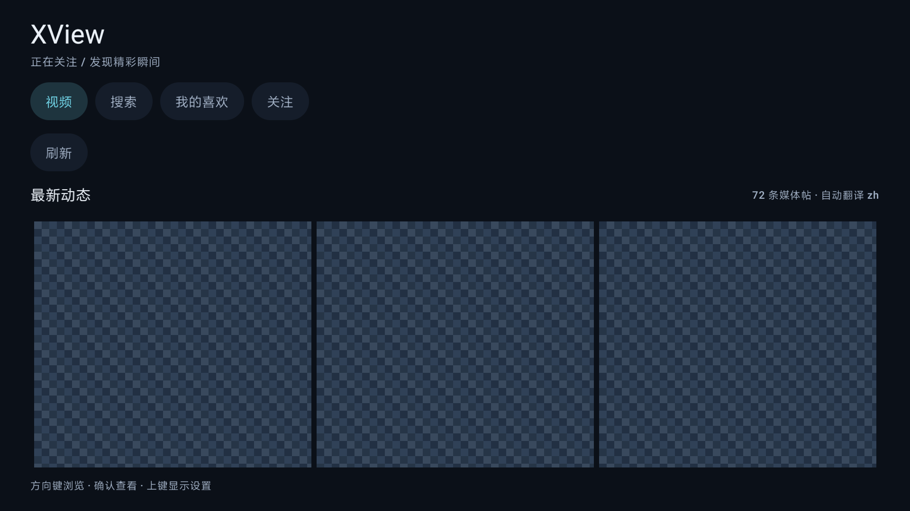

<p align="center"></p>

# XView

<p align="center"></p>

[](https://github.com/TanCan1998/xview-tv/actions/workflows/ci.yml)
[](https://github.com/TanCan1998/xview-tv/releases/tag/v1.0.1)
[](docs/compatibility/android-tv.md)
[](LICENSE)

支持 Android 手机、平板与 Android TV / Google TV 的媒体优先 X 客户端，基于 Kotlin 与 Compose for TV。[产品设计](docs/design/xview-tv.md)描述现行功能与媒体规划。

当前只构建一个应用，包名 `io.github.tancan1998.xviewtv`，不提供 Demo 版本。手机首页常驻设置入口，电视按遥控器菜单键显示/隐藏唯一的“设置”按钮；登录与代理位于设置内，返回按“子页 → 设置 → 首页”处理。

已实现：

- 中英文国际化：首次根据系统语言自动选中并保存简体中文或英文，不支持的语言回退英文；设置仅显示受支持语言，可即时切换，设置及播放秒数持久保存；网页配对跟随手机浏览器语言。
- 手机竖屏、横屏与电视自适应，统一深色青色卡片与焦点；手机可直接填写完整 Cookie，验证身份并确认后加密保存。
- 硬件解码优先；长按画面右侧临时加速，松手/取消恢复原倍速；双击左侧后退、右侧前进，分别设置 5/10/15/30/60 秒。
- 当前筛选媒体队列支持上一视频/下一视频，跳过图片，首尾不循环。

- 局域网扫码登录：电视临时提供网页与二维码，手机粘贴完整 Cookie，核对设备校验码后加密提交；电视通过 X 网页验证身份，用户确认后使用 Android Keystore 加密保存。
- 直连、无认证 HTTP/SOCKS5 代理配置、格式校验、本地持久化和手动 HTTPS 连通性检测。代理失败不回退直连，不修改系统代理。
- 账号冷启动恢复、手动重新验证和本地退出；不提供敏感内容隐藏开关或本地过滤。应用不内置本机浏览器导入入口，也不自动读取其他应用 Cookie。

- 正在关注账号的真实媒体流：X 网页 GraphQL 动态操作发现、游标分页/去重、有界窗口；现代深色媒体卡片、筛选、Lazy 网格控件复用。
- 通过 X 网站功能自动翻译可见帖子为设备当前语言；失败保留原文。
- 手机列表隐藏刷新按钮并支持到顶下拉刷新；电视保留刷新按钮。头像与关注卡片使用统一圆角，配色、形状和语言选项集中在设计系统资源。
- 视频首页、全站视频搜索、我的喜欢、关注列表四个入口；移除图片筛选和全屏图片页面。关注列表可选择博主观看其原创及转发视频，全部支持游标分页；接口本地实测见[视频库接口](docs/development/video-library-api.md)。
- AndroidX Media3 开源播放控件：HLS、MP4清晰度、倍速、进度条、快进退；页面离开/后台释放资源。见[媒体实现](docs/development/media-playback.md)。

电视扫码时手机与电视必须处于同一局域网。手机直接登录无需配对端口。无需公网 HTTPS、中继或伴随 App；电视配对端口仅在配对时开放，3 分钟过期，离开登录页或切后台即关闭。浏览器若报 `ERR_LOCAL_NETWORK_PERMISSION_MISSING`，需在手机浏览器应用权限中手动允许本地网络访问，再重新生成二维码扫码。HTTP 页面与应用层密文的信任边界见[登录决策](docs/adr/006-qr-cookie-login.md)。

账号验证使用 `https://x.com/home` 当前网页会话数据；媒体和翻译仅使用X同源网页接口，不使用 Android 私有接口或付费 API。现支持最多20个账号加密保存、免重填Cookie切换和独立移除，旧单账号在下次写入时迁移；切换重建客户端并清理前一账号的页面与缓存。电视隐藏控件时左右键/长按连续快进快退、OK播放暂停，倍速与队列按钮放在32dp紧凑外栏；视频库接口已用本机保存会话实测，页面测试范围以验证记录为准。手机与 TV 的本次安装验收见[验证记录](docs/development/verification.md)。

最低系统 API23（Android 6.0），compile37/target35；账号使用 Keystore 加密保存。现已在小米 MiTV-ANSP0（Android9/API28、armeabi-v7a）实测局域网网页填 Cookie、电视身份确认、加密保存、冷启动恢复、重新验证和本地退出；其他设备及版本未认证。测试 Cookie 未入仓。

## 界面预览

以下为 1.0.0 实际运行截图。账号身份、头像、帖子正文、视频缩略图及其他个人内容均已不可逆打码；导航、卡片边界、控件和 TV 焦点保留。图片使用仓库相对路径。

| 手机首页 | 手机设置 |
| --- | --- |
|  |  |



## 构建与验证

JDK17、SDK37 / Build Tools36.0.0、Gradle9.9.1、AGP9.5.1、Kotlin2.4.21，Android 模块使用内置 Kotlin；CI 固定 Node26.13.1。见 [GitHub 构建配置](docs/development/github-build.md)。

```sh
python3 tools/scripts/verify_project.py
node web/pairing/tests/node.mjs
node web/pairing/tests/lan-node.mjs
sh ./gradlew :core:network:test :core:domain:test :core:provider:test :provider:demo:test :app:lintDebug :app:assembleDebug
```

Debug APK：`app/build/outputs/apk/debug/app-debug.apk`，不是发布签名包。小体积本地验收包执行`sh ./gradlew :app:assembleOptimized :app:lintOptimized`，输出`app/build/outputs/apk/optimized/app-optimized.apk`：R8代码裁剪/混淆与资源压缩，非debuggable、保留中英文与全部ABI，使用本机debug证书以覆盖现有测试安装。正式发布的 APK 由 GitHub Actions 构建并以仓库加密 Secret 中的现有签名重新签署；源代码不包含签名密钥。Release 也启用压缩，独立构建者应配置自己的签名。挂载目录请用 `sh ./gradlew`；通过 `ANDROID_HOME` 配置 SDK。本机 ARM64 Alpine 离线入口与实际测试证据见[验证记录](docs/development/verification.md)。

`provider:demo` 仅保留确定性测试夹具，不依赖于正式 APK；`feature:home` 已接入真实媒体首页。当前9个模块的边界见[架构](docs/architecture/overview.md)。

[路线图](docs/development/roadmap.md) · [兼容矩阵](docs/compatibility/android-tv.md) · [隐私](PRIVACY.md) · [贡献指南](CONTRIBUTING.md)

[GitHub 源码](https://github.com/TanCan1998/xview-tv) · [下载 1.0.1](https://github.com/TanCan1998/xview-tv/releases/tag/v1.0.1)。Apache-2.0，第三方组件许可见[来源记录](licenses/third-party/README.md)。

## 社区链接

[LINUX DO](https://linux.do/)：真诚、友善、团结、专业的技术社区。认可社区的开源交流理念，欢迎佬友交流使用体验与改进建议。
