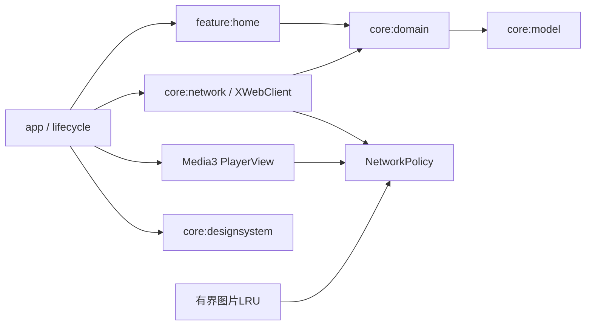

# Architecture

## 正式单包

`io.github.tancan1998.xviewtv`只装配真实应用。`AppShell`管理设置/登录/代理及返回；`feature:home`是现代媒体Lazy网格，稳定key/contentType、可见区域翻译、游标分页。有界领域窗口最多160条，重复游标停下。`provider:demo`仅确定性测试夹具，不进入正式APK。

## X网页与凭据边界

扫码登录网页静态资源内置；`LanPairingServer`临时随机端口/ID/RSA，180秒，同源Host/Origin，单次密文。完整Cookie仅手机临时解析，TV只接必需会话，`/home`身份匹配后用户确认Keystore加密存储。不提供明文回退。测试不增加自动读取浏览器的产品入口。

`XWebClient`按账号和代理生命周期创建。当前`/home`及公开main/HomeTimeline分块只提取操作/feature，不eval脚本；GraphQL真实关注时间线、分页、HTTPS媒体变体；X/Grok同源翻译，404/405尝试X原生翻译，403/429冷却。凭据只能发到x.com，媒体请求不携带Cookie，关闭跨站重定向。主页、搜索、多账号、长期风控与完整transaction生成未完成。

## UI、播放与资源所有权

深色青色主题、统一圆角卡片、16:10附近缩略图、时长/数量标签、两行摘要；D-pad焦点描边/小比例放大。Lazy网格只组合当前/预取窗口；翻译限可见帖子，串行缓存最多160项。图片LRU12MiB、2路下载解码、采样1280，响应6MiB封顶。

播放使用开源Media3标准PlayerView，不自制播放/拖动控件；清晰度取X变体或HLS自动选择，切换保留进度/倍速/状态。缓冲目标16MiB/5–15秒，无大型FFmpeg扩展。参考Just Player TV交互，来源/许可见[媒体设计](../development/media-playback.md)。

只在Activity RESUMED时持有媒体客户端/图片/播放器；离开/暂停销毁绑定、Listener、媒体项、ExoPlayer与图片LRU。TLS响应关闭/Call.cancel/连接池释放在IO执行，避免主线程网络异常。调试活跃播放器仅原子计数，不保留Context。当前PSS/短循环不是heap泄漏证明，需继续长时/强制GC/retained对象与其他设备验收。
